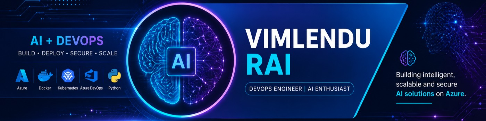

<!-- ================= PROFILE BANNER ================= -->

<p align="center">
  
</p>

<h1 align="center">Hi 👋, I'm Vimlendu Shekhar Rai</h1>

<h3 align="center">
  Generative AI & DevOps Engineer | Azure Cloud | AI Infrastructure
</h3>

<p align="center">
  
</p>

<p align="center">
  <a href="https://www.linkedin.com/in/vimlendu/">
    
  </a>
  <a href="https://github.com/Vimlendu27">
    
  </a>
  <a href="mailto:vimlendu.shekharrai97@gmail.com">
    
  </a>
</p>

<p align="center">
  
</p>

---

## 👨‍💻 About Me

I'm a DevOps Engineer with **6.5+ years of overall IT experience and 5.5+ years in DevOps**, focused on Azure cloud infrastructure, CI/CD automation, Infrastructure as Code, Kubernetes, and cloud security.

I'm expanding my expertise into **Generative AI Engineering**, with a focus on integrating AI into cloud-native platforms and deploying intelligent applications.

- ☁️ Designing and automating Azure cloud infrastructure.
- ⚙️ Building CI/CD pipelines and Infrastructure as Code.
- 🐳 Working with Docker, Kubernetes, and Azure Kubernetes Service (AKS).
- 🤖 Exploring Azure OpenAI, LLMs, RAG, embeddings, and AI Agents.
- 🔐 Focusing on secure deployments, identity management, and cloud governance.
- 🚀 Interested in AI application deployment, LLMOps, and AI-powered DevOps automation.


<br clear="right"/>

## 🧠 AI Engineering Focus

| Area | Technologies & Concepts |
|---|---|
| Generative AI | Azure OpenAI, LLMs, prompt engineering |
| RAG | Document ingestion, chunking, embeddings, retrieval, generation |
| Vector Search | Azure AI Search, semantic and vector retrieval |
| AI Agents | Tool calling, agent workflows, MCP concepts |
| AI Deployment | APIs, Docker, AKS, CI/CD, monitoring |
| LLMOps | Evaluation, observability, security, deployment automation |

## ☁️ DevOps & Cloud Engineering

| Area | Technologies |
|---|---|
| Cloud | Microsoft Azure |
| CI/CD | Azure DevOps Pipelines, YAML, Git |
| Infrastructure as Code | Terraform, Bicep |
| Containers | Docker, Kubernetes, AKS |
| Networking | VNets, Subnets, NSGs, Private Endpoints |
| Security | Azure Key Vault, RBAC, Managed Identity |
| Monitoring | Azure Monitor, Log Analytics |
| Data & Automation | Python and SQL fundamentals; expanding hands-on skills |

## 🏗️ Featured Architecture & Project Ideas

### 1. 🤖 AI-Powered Kubernetes Troubleshooting Agent

**Goal:** Explore how AI can assist DevOps engineers in diagnosing Kubernetes issues.

```text
Azure Monitor Alert
        ↓
AI Agent / Orchestrator
        ↓
MCP Tools / Kubernetes API
        ↓
Pods • Events • Logs • Metrics
        ↓
LLM Analysis
        ↓
Root Cause & Recommended Actions
        ↓
Engineer Review
```

**Engineering focus:**
- Retrieve relevant Kubernetes diagnostics.
- Use an LLM to summarize evidence and suggest possible causes.
- Apply least-privilege access and read-only diagnostics by default.
- Require human approval before any production-changing action.

### 2. 📚 Retrieval-Augmented Generation (RAG) Assistant

**Goal:** Build an assistant that answers questions from approved technical documents.

```text
Documents
    ↓
Text Extraction & Chunking
    ↓
Embeddings
    ↓
Vector Search / Azure AI Search
    ↓
Relevant Context + User Question
    ↓
Azure OpenAI
    ↓
Grounded Answer with Sources
```

**Engineering focus:** Document ingestion, retrieval quality, access control, API deployment, monitoring, and CI/CD.

### 3. 🚀 Cloud Infrastructure Automation

**Goal:** Build repeatable and secure infrastructure deployments.

```text
Git Repository
      ↓
Azure DevOps Pipeline
      ↓
Terraform Plan
      ↓
Review & Approval
      ↓
Terraform Apply
      ↓
Azure Resources
      ↓
Monitoring & Alerts
```

**Engineering focus:** Reusable modules, remote state, environment separation, security controls, and deployment validation.

> These are portfolio architecture examples and project directions. Link each section to a working implementation when the corresponding repository is available.

## 🛠️ Languages & Tools

<p align="center">
  
</p>

<p align="center">
  
  
  
  
</p>

## 📈 GitHub Analytics

<p align="center">
  
  
</p>

<p align="center">
  
</p>

## 🎯 Current Learning Roadmap

- [ ] Build and deploy a complete RAG application.
- [ ] Integrate Azure OpenAI with secure APIs.
- [ ] Deploy an AI application to AKS using CI/CD.
- [ ] Build a Kubernetes troubleshooting assistant.
- [ ] Implement monitoring, evaluation, and security for AI applications.
- [ ] Explore MCP-based tool integration and agent workflows.

## 🤝 Let's Connect

I'm interested in connecting with professionals working in **Generative AI, Azure Cloud, DevOps, Platform Engineering, and AI Infrastructure**.

<p align="center">
  <a href="https://www.linkedin.com/in/vimlendu/">
    
  </a>
  <a href="https://github.com/Vimlendu27">
    
  </a>
</p>

<p align="center">
  <b>BUILD • AUTOMATE • DEPLOY • SECURE • INNOVATE</b>
</p>

<p align="center">
  <i>Bringing Cloud Engineering and Generative AI together.</i>
</p>
